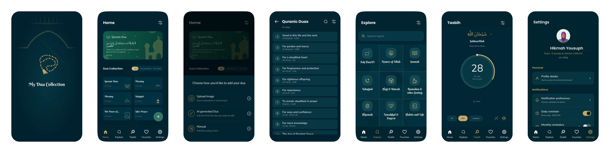
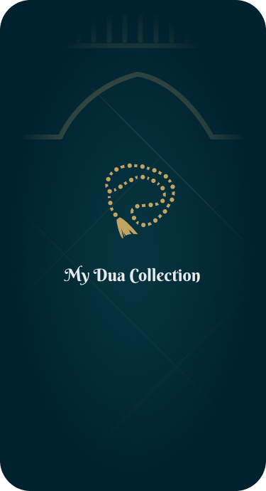
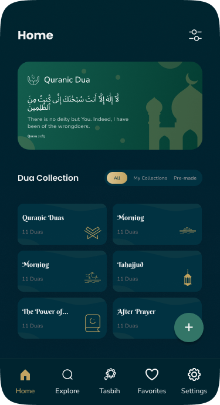
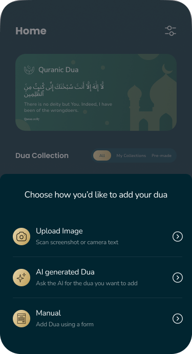
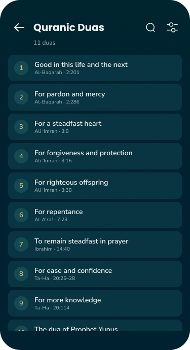
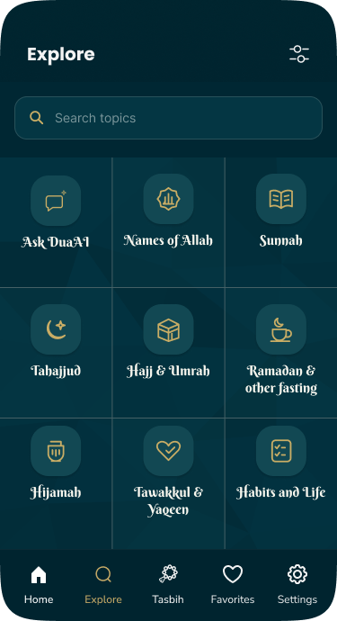
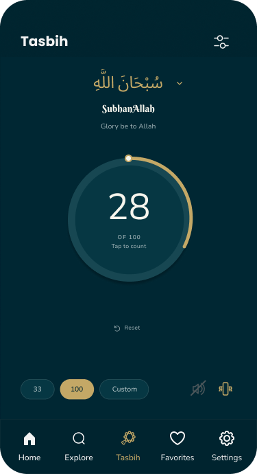

# My Dua Collection App


A mobile app for organizing, finding and practicing Islamic supplications (duas) and dhikr, built with React Native and Expo. It ships with a library of duas, works offline, and has dark and light themes.

> This is the overview. The full specification, design system, data model and complete to-do list are in [README_COMPREHENSIVE.md](README_COMPREHENSIVE.md).

## Table of Contents

- [Overview](#overview)
  - [Introduction](#introduction)
  - [Features](#features)
- [Screens & Functionality](#screens--functionality)
  - [Splash Screen](#splash-screen)
  - [Home](#home)
  - [Add a Dua](#add-a-dua)
  - [Collection](#collection)
  - [Bookmark](#bookmark)
  - [Explore](#explore)
  - [Tasbih](#tasbih)
  - [Settings](#settings)
  - [Dark and Light Mode](#dark-and-light-mode)
- [Architecture](#architecture)
- [Getting Started](#getting-started)
- [Built With](#built-with)
- [To Do](#to-do)
- [Documentation](#documentation)
- [Author](#author)

---

## Overview

### Introduction

My Dua Collection helps Muslims keep their daily supplications in one place. Duas are grouped into collections (a dua can belong to several), shown with their Arabic text, transliteration and translation, and referenced to the Quran or hadith they come from. The focus is on **a clean, distraction-free reading experience**, **fast search that understands Arabic**, and **a dhikr counter that is pleasant to use**.

### Features

Users can currently:

- Browse the pre-made collections (Quranic Duas, Morning, Evening, Tahajjud, The Power of..., After Prayer and Dhikr) on the Home screen, filter them with the All, My Collections and Pre-made tabs, and read a featured dua.
- Open a collection to see its duas in a numbered list, each with its source (for example `Al-Baqarah · 2:201`).
- Filter a collection, or the favorites, by one surah or hadith name.
- Search duas by title, transliteration, Arabic (without needing the diacritics), translation, or surah and hadith name.
- See the favorite duas together with the collections each one belongs to.
- Add a dua by hand (title, Arabic, translation, collections, and an optional source and reference) and keep it on the device.
- Count dhikr with the Tasbih: a progress ring, targets of 33, 100 or any custom number, sound and vibration feedback, and a shake when the target is reached.
- Read the full dua being counted and switch to another one, from 10 presets or a search across every dua.
- Browse the Explore topics and search them.
- Switch between dark and light mode, and have the choice remembered.
- Use everything without a connection, because the duas ship with the app.

---

## Screens & Functionality

> The images below are the app's screen designs. They are kept in `public/readme/`.

### Splash Screen

<p align="center">
  
</p>

- A plain `#00212E` native splash, so there is no white flash when the app opens.
- An animated splash with the prayer-mat artwork then fades out once the fonts, saved theme, duas and Tasbih state have loaded.
- The artwork is an SVG scaled to cover any screen size.

---

### Home

<p align="center">
  
</p>

- Featured dua banner with the Arabic, translation and Quran reference.
- Tabs: All, My Collections and Pre-made.
- Collections grid (2 columns on phones, 3 or 4 on larger screens) with an icon and the dua count on every card.
- Tapping a collection opens it.
- A "+" button opens the add-dua modal.
- The filter icon opens the Appearance menu (Dark or Light).

---

### Add a Dua

<p align="center">
  
</p>

- The "+" button offers three ways to add a dua: Upload Image, AI generated Dua and Manual. Only **Manual** works for now.
- The form takes a title, the Arabic text, a translation, the collections it belongs to, and an optional source and reference.
- The reference is checked: Quran references look like `21:87` or `11:39-42` and the surah number must be 114 or less.
- Saved duas are stored on the device and the collection counts update straight away.

---

### Collection

<p align="center">
  
</p>

- Header with a back arrow, the collection name, a count such as "11 duas", a search icon and a filter icon.
- One numbered row per dua with its title and source line.
- **Search** opens under the header and finds duas by title, transliteration, Arabic, translation, or surah and hadith name. It ignores Arabic diacritics, apostrophes and hyphens, so "ali imran" finds "Ali 'Imran".
- **Filter** (the filter icon menu) lists the surahs and hadith collections found in this collection. Pick one, and tap it again to clear it. A gold dot shows a filter is on.

---

### Bookmark

- Lists every favorite dua in the same design as a collection.
- Small pills show which collections each dua belongs to (two at most, then "+N").
- The same search and surah or hadith filter as the Collection screen.
- Saving a dua with a bookmark button comes with the dua detail view, which is next.

---

### Explore

<p align="center">
  
</p>

- A 3x3 grid of topics (Ask DuaAI, Names of Allah, Sunnah, Tahajjud, Hajj & Umrah, Ramadan & other fasting, Hijamah, Tawakkul & Yaqeen, Habits and Life) that fills the space between the search bar and the tab bar.
- Search filters the topics by name.
- Each theme has its own pattern background and icon boxes.
- The topic screens are still to build.

---

### Tasbih

<p align="center">
  
</p>

- A large circle: tap anywhere on it to count. A gold arc fills towards the target.
- Targets of 33 and 100, or a custom number from 1 to 99,999. Changing the target asks first when there is a count to lose.
- Reset with a confirmation.
- Sound and vibration toggles. Every tap gives a light tick, and reaching the target gives a stronger vibration, a chime and a shake of the circle, for the target and the next two taps.
- Tap the Arabic text to read the full dua (title, Arabic, transliteration, translation) and choose **Change dua**: 10 presets, or a search across every dua. Changing the dua resets the count, after a confirmation.
- Count, target, dua and the two toggles are saved and restored when the app reopens.

---

### Settings

- The tab is a placeholder for now.
- Dark and light mode can already be switched from the filter icon on the Home, Explore, Tasbih, Collection and Bookmark screens.

---

### Dark and Light Mode

- Dark is the default, with deep teal and gold accents.
- The choice is saved on the device and restored on launch.
- Colors are defined once per screen for both modes, on top of a shared palette.

---

## Architecture

- **Data** — the duas live in `data/data.json` (33 duas, including 18 dhikr) and always load from there. The copy saved on the device (`duas:v2`) keeps only what the user changed: the ids of the favorite duas and the duas they added. `data.json` holds no user state, so it has no `isFavorite`.
- **State** — Redux Toolkit slices for duas, settings and the Tasbih, persisted with AsyncStorage (the Tasbih saves are debounced so fast tapping does not hammer storage).
- **Routing** — Expo Router: the five tabs, plus `collection/[id]` for a collection and `modal` for adding a dua.
- **Shared parts** — one `ScreenHeader`, one `SearchField`, and one list screen (`DuaListScreen`) that both the Collection and Bookmark screens use.
- **Search and filter** — a single `useSearch` hook for every search box, and `useSourceFilter` for the surah and hadith filter.
- **Theming** — Tailwind classes (twrnc) with a shared color palette mirrored in code, and a theme file per screen for the colors that classes cannot reach (SVG and icon props).
- **Icons** — SVG files are the source of truth, and the React Native components are generated from them with a script, so the same icons work as collection covers, Explore topics and a future icon picker.
- **Arabic text** — one `ArabicText` component, because Amiri's diacritics are clipped unless the line height is generous.
- **Splash** — a plain native splash, then an animated splash drawn from an SVG imported as a component.
- **Feedback** — `expo-haptics` for vibration and `expo-audio` for the tap tick and the target chime, without pausing the user's music.

---

## Getting Started

You need Node.js and either the Expo Go app on your phone or an iOS simulator or Android emulator.

```bash
git clone https://github.com/Hikmahx/my-dua-collection.git
cd my-dua-collection
npm install
npx expo start
```

Then press `i` (iOS simulator), `a` (Android emulator) or scan the QR code with Expo Go.

- After changing `metro.config.js` or adding a dependency, restart with `npx expo start -c` to clear the cache.
- The native splash color is set in `app.json`, so a change to it needs a development build (`npx expo prebuild`), not Expo Go.

---

## Built With

- [React Native](https://reactnative.dev/) - Mobile framework
- [Expo](https://expo.dev/) (SDK 54) and [Expo Router](https://docs.expo.dev/router/introduction/) - Tooling and file-based routing
- [TypeScript](https://www.typescriptlang.org/) - Typed JavaScript
- [Redux Toolkit](https://redux-toolkit.js.org/) - State management
- [twrnc](https://github.com/jaredh159/tailwind-react-native-classnames) - Tailwind CSS for React Native
- [React Native SVG](https://github.com/software-mansion/react-native-svg) and [react-native-svg-transformer](https://github.com/kristerkari/react-native-svg-transformer) - Icons and the splash artwork
- [React Native Reanimated](https://docs.swmansion.com/react-native-reanimated/) - Animations
- [React Hook Form](https://react-hook-form.com/) - Add-a-dua form
- [AsyncStorage](https://react-native-async-storage.github.io/async-storage/) - Offline storage
- [Expo Haptics](https://docs.expo.dev/versions/latest/sdk/haptics/) and [Expo Audio](https://docs.expo.dev/versions/latest/sdk/audio/) - Tasbih feedback
- [Google Fonts](https://fonts.google.com/) - Nunito Sans, Berkshire Swash and Amiri (Arabic)
- [Figma](https://www.figma.com) - UI design

---

## To Do

- [ ] Dua detail view (open a dua from the Collection and Bookmark lists)
- [ ] Bookmark button to save and unsave duas
- [ ] Create, edit and delete collections, and sort duas
- [ ] Collections list view and reorganizing collections
- [ ] Settings screen
- [ ] Explore topic screens and a universal search
- [ ] AI chat assistant
- [ ] Image upload (OCR) to add a dua
- [ ] Audio recitations
- [ ] Reminders and Ramadan mode
- [ ] Share cards and PDF export
- [ ] Backend and cloud sync

The full list is in [README_COMPREHENSIVE.md](README_COMPREHENSIVE.md#to-do).

---

## Documentation

[README_COMPREHENSIVE.md](README_COMPREHENSIVE.md) is the detailed reference: the feature specification, screen-by-screen breakdown, the dua data model, the design system and conventions (theming, icon library, search, project structure), and the full to-do list.

---

## Author

👩‍💻 **Hikmah Yousuph**
- Portfolio: [Hikmah Yousuph](https://hikmah-yousuph.vercel.app)
- GitHub: [Hikmahx](https://github.com/Hikmahx)
- Email: [hikmayousuph@gmail.com](mailto:hikmayousuph@gmail.com)
- LinkedIn: [linkedin.com/in/hikmah-yousuph](https://linkedin.com/in/hikmah-yousuph)
